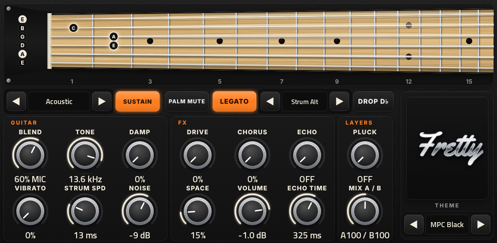
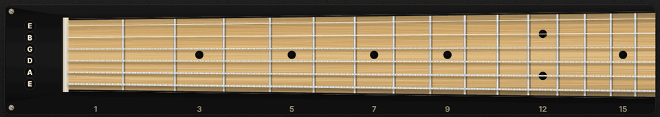
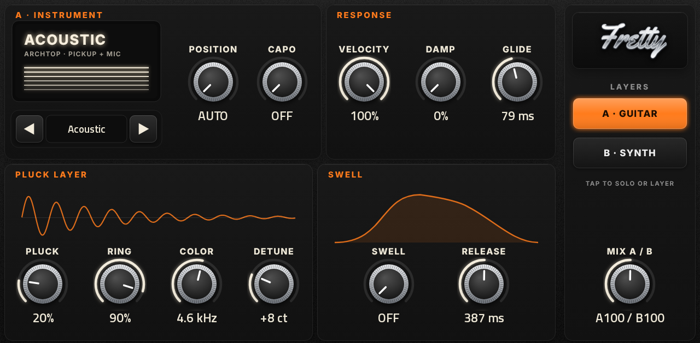
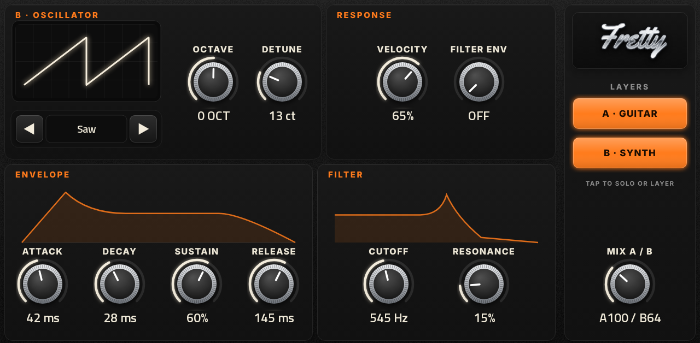
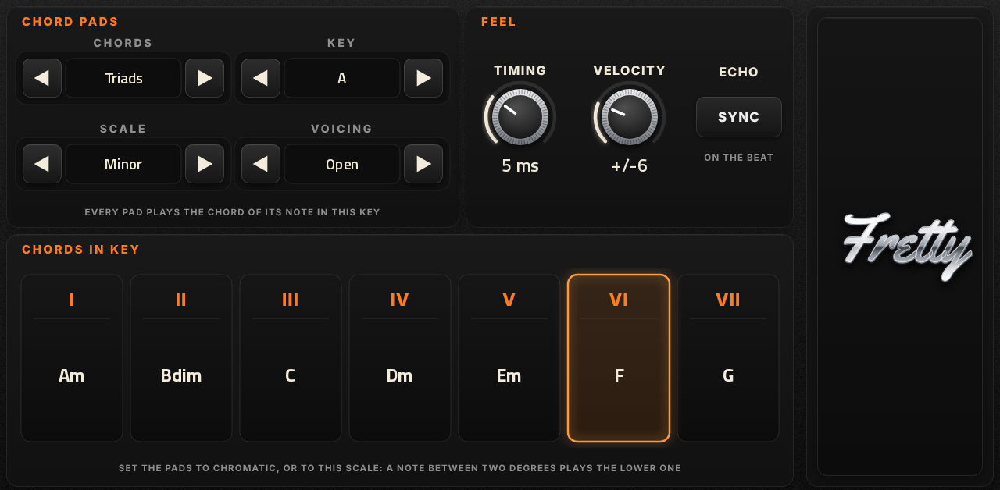
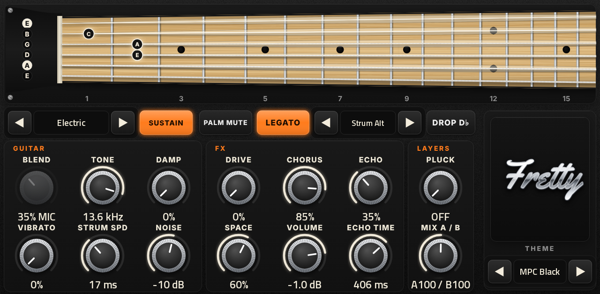
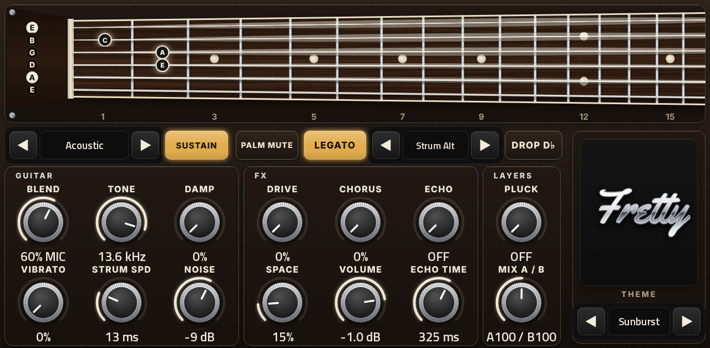
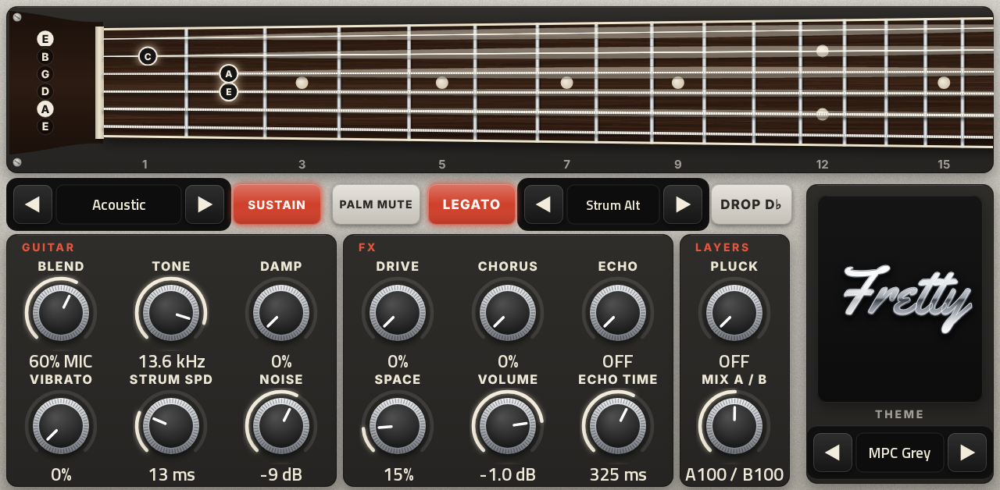

# Fretty

A guitar instrument for Akai MPC OS standalone devices (native VST2, built with
[mpc-vst-plugins](https://github.com/sd88me/mpc-vst-plugins)), with a synth layer as a twist.
Status: **v0.8.3, tested on an MPC.** Ten real instruments, all CC0, so it can be shared freely.





At its core it plays real, clean, raw recordings on a six-string playing model; drive, chorus, the pluck layer and
the synth turn that into many more sounds without a sample library.

Four pages: **PLAY** (the neck, instrument, strum and the main knobs), **LAYER A** (the instrument in detail),
**LAYER B** (the synth) and **PERFORM** (chord pads and feel). Each page has its own Q-Links.

| LAYER A | LAYER B |
| --- | --- |
|  |  |
| **PERFORM** | **PLAY, with the electric** (knobs that do nothing for it are dimmed) |
|  |  |

Three themes, picked with THEME ◀ ▶: MPC Black, Sunburst and MPC Grey.

| Sunburst | MPC Grey |
| --- | --- |
|  |  |

## Layer A: the instrument (INSTRUMENT ◀ ▶ on the PLAY page or LAYER A)
| Instrument | Recording | Notes |
| --- | --- | --- |
| Acoustic | Karoryfer Shinyguitar, an archtop | pickup and microphone of the same take: BLEND mixes them |
| Electric | Karoryfer Emilyguitar, an Epiphone SG (flatwounds) | straight from the pickups, no amp: add DRIVE / CHORUS |
| Folk Harp | VCSL | stereo |
| Concert Harp | VCSL | stereo |
| Strumstick | VCSL, finger-picked | between a banjo and a guitar |
| Violin | VSCO 2 CE Solo Violin, bowed with vibrato | held notes keep bowing (a crossfaded loop) |
| Violin Pizz | VSCO 2 CE Solo Violin, pizzicato | plucked |
| Dan Tranh | VCSL, a Vietnamese zither (steel strings) | retuned to equal temperament per note |
| Psaltery | VCSL, plucked | metal strings, bell-like, high register |
| Bowed Psaltery | VCSL, bowed | held notes keep bowing (a crossfaded loop) |

All CC0 (public domain), so the plugin can be shared. Each instrument loads the first time it is picked (a few
seconds on the MPC: "LOADING SAMPLES…" shows over the neck) and stays loaded while it is in use. When another instrument loads, any that no Fretty has had picked for 20
seconds are released from memory (picked again, they load again). Knobs that do
nothing for the picked instrument are dimmed (BLEND is the archtop's alone; NOISE has recordings for the two guitars).

## How it plays
- **Six strings.** Every note is placed on a string and fret. A chord that arrives together is spread across strings
  like a real voicing; POSITION fixes the hand at a fret (AUTO follows the music), CAPO and DROP D♭ change the strings.
- **One sound per string.** A new note on a string cuts the old one off. With **LEGATO** on, playing a new note while the
  previous key on that string is still held slurs into it (a hammer-on or pull-off) instead of re-picking.
- **STRUM** (◀ ▶): Down (low string first), Up (high first, a little lighter), Alt (down / up while the chords keep
  coming; a pause of a second starts again on a down stroke) or Off. STRUM SPD sets the gap. A bowed violin plays
  chords together.
- **Articulations:** SUSTAIN or PALM MUTE (also on keyswitches A♯0 / B0).
- **PLUCK** layers a plucked-string model under the samples (off at zero). PLUCK is on the PLAY page; all four of its
  knobs (PLUCK, RING, COLOR, DETUNE) are on LAYER A, with POSITION and CAPO.
- **GLIDE** (LAYER A): with LEGATO on, a note played while the previous one is still held slides into it, like a
  steel guitar's bar or a bent zither string. LEGATO keeps an overlapped single note on the held string.
- **LAYER A** also has VELOCITY (how much the level follows how hard you play; the soft / hard recordings always
  follow it), DAMP, SWELL (fade notes in, like a volume knob) and RELEASE (let released notes ring on).
- Mod wheel adds vibrato; pitch bend is ±2 semitones. Velocity picks soft / medium / hard recordings.
- The neck shows each played string glowing at its fret, settling as it fades.

## Layer B: the synth (LAYER B page)
Every note can also play two detuned oscillators (SINE, TRIANGLE, SAW, SQUARE, picked with ◀ ▶ and shown on the
screen) through a resonant low-pass FILTER and an ATTACK / DECAY / SUSTAIN / RELEASE envelope, with OCTAVE, DETUNE,
VELOCITY and FILTER ENV (the envelope opens the filter: plucks and swells).

**A · GUITAR** and **B · SYNTH** (on both layer pages) switch each layer on or off: both on to layer them, one off to
solo the other. **MIX A / B** (on every page) balances them while both are on: fully left is A alone, the middle is
both at full, fully right is B alone.

## Perform (PERFORM page)
- **CHORD PADS:** CHORDS (Off, Triads, 7ths), KEY, SCALE (Major, Minor, Dorian, Mixolydian, Harm Minor, Phrygian)
  and VOICING (Open: five strings from the A string; Barre: six strings from the low E; High: a close shape on the
  top strings). Every note you play becomes the chord of its degree in that key, strummed and voiced string by string
  like a real chord shape. Set the MPC pads to chromatic or to the same scale; a note between two degrees plays the
  lower one. The seven tiles show the key's chords, and the one playing lights up. Two pads that share notes keep
  them ringing until both let go.
- **FEEL:** TIMING (each hit up to 18 ms late at random, and each strummed string a little uneven) and VELOCITY
  (up to +/-22 at random). Off at zero.
- **ECHO SYNC:** the ECHO TIME knob steps through note lengths (1/32 to 1/2, with triplets and dotted) at the
  project's tempo. Off: milliseconds.
- Presets never change the PERFORM settings (like the THEME).

## Effects (PLAY page)
DRIVE (an amp-style clipper, from warm to distorted), CHORUS, ECHO (a stereo ping-pong delay whose repeats get
darker; ECHO TIME 60 ms to 1 s), SPACE (room reverb), then VOLUME. Each is completely off
at zero, so the default sound is the raw recording.

## Presets
110 presets in MPC's PRESET menu, alphabetized by category and name (the tag leads each name):
- **ACO** acoustic: Clean Archtop, Acoustic Strum, Nylon-Style Soft, Front Porch, Funk Mutes, Ballad Strum, Lead Lines
- **ELE** electric: Clean Electric, Chorus Clean, Crunch, Distorted Rhythm, Electric Mutes, Surf-ish, Lead Drive,
  Volume Swells
- **80S** late-80s / post-punk: Chorus Wash, Bass VI Melody (play it an octave down), Cold Wave Layers, Post-Punk
  Grit, Cold Room Clean
- **STL** steel and slide: Lap Steel, Pedal Steel Swells, Dobro Slide, Weissenborn Slide
- **HRP** harps: Folk Harp, Concert Harp Glide, Island Harp
- **VLN** violin: Violin Lead, Electric Violin, Violin Pizzicato
- **ZTH** zithers: Dan Tranh, Dan Tranh Bends, Psaltery, Bowed Psaltery, Hammered Dulcimer
- **FLK** folk: Strumstick Banjo, Old-Time Picker, Mountain Dulcimer, Saz Picking, Gusli Village, Wanderer's Lute,
  Kemenche Lament, Tavern Fiddle, Wheel Drone (play it low)
- **SYN** A + B: Guitar + Pad, Violin + Pad, Plucked Glass, Electric Saw Lead, Synth Pluck B Solo, Synth Pad B Solo

Presets never change the THEME or the PERFORM settings.

Some sounds have no free recordings that can be shared, so they are built from the closest real ones:
- **Nylon-Style Soft**: the archtop's microphone, softened and darkened.
- **Electric Violin**: the violin through a little drive and chorus.
- **Hammered Dulcimer**: the dan tranh's steel strings with a bright, doubled pluck layer (a hammered dulcimer has
  two or more strings per note).
- **Mountain Dulcimer**: the strumstick, a close cousin, strummed.
- **Saz / lute / kemenche / hurdy-gurdy colours**: the dan tranh (steel strings, slides), the psaltery (a gusli
  relative), the archtop's mic dulled to a lute-like tone, the violin darkened with a little rasp, and the violin over
  a buzzing square-wave B layer for the wheel drone.
- **Lap Steel / Pedal Steel Swells / Dobro Slide / Weissenborn Slide**: the electric or the archtop with GLIDE (play legato: overlap the
  notes), vibrato and, for the pedal steel, SWELL.

`tools/make_presets.py` writes `vst/presets.json`.

## Extra keys
| Keys | Sound |
| --- | --- |
| C0–F0 (12–17) | dead (muted) string (acoustic and electric) |
| F♯0–A0 (18–21) | muted strings strummed (acoustic) / finger squeak (electric) |
| A♯0 / B0 (22 / 23) | keyswitch: Sustain / Palm Mute |
| C1–D♯1 (24–27) | body knocks (acoustic) |
| A1 and up | the instrument (D♭2 with DROP D♭ on) |

## Build
From Ubuntu (WSL on Windows, or any Linux) with Docker, `git` and `python3`:

```sh
git clone https://github.com/3dthc/fretty-mpc.git ~/fretty-mpc
bash ~/fretty-mpc/install.sh
```

`install.sh` checks Docker, fetches [mpc-vst-plugins](https://github.com/sd88me/mpc-vst-plugins) next to this folder if
it is missing, builds, and leaves `dist/Fretty-<version>-mpc-armv7.zip` (also copied to Windows Downloads under WSL).
Install that zip on the MPC like any other plugin from mpc-vst-plugins. In a checkout that already has
`mpc-vst-plugins` beside it, `bash make_release.sh` alone builds. (Without git, the release's split zips work too:
unzip `fretty-mpc-v<version>.zip` into your home folder with the instrument zips in Downloads, then run `install.sh`.)

The instruments ship ready in `engine/*.smp` (losslessly compressed, ~67 MB in all); the plugin needs that `engine/`
folder next to `fretty.so` in its plugin folder (`make_release.sh` puts it there).

**The essential sample sets:** up to three velocity layers and the two most typical takes of each, notes up to 4 s
with a natural fade, two takes of every release and noise. Each instrument gets a level trim so they all play at the
same loudness. `tools/pack_samples.py` rebuilds them from the sources (needs `python3-numpy`):

```sh
python3 -I tools/pack_samples.py engine --shiny <karoryfer.shinyguitar> --emily <karoryfer.emilyguitar> --vcsl <VCSL> \
    --vsco <VSCO-2-CE>
```

`tools/check_codec.c` checks every file decodes bit-exactly.

## The pages
`tools/make_skin.py` draws all the artwork (backgrounds per theme for the three pages, the chrome wordmark, the knob and
its dimmed twin, the switches, the waveform and instrument screens, the loading banner and the string pictures) and writes `vst/layout.conf`; its output in `vst/art/` is
committed, so the build only reads it. Each string has two display filmstrips driven by the engine (`s<n>_vib`: ring
level 0-3, `s<n>_fret`: the lit fret). MPC only swaps those pictures when a value changes (a few times per note).

## Offline checks
- `../mpc-vst-plugins/tools/test_port.sh vst/vst.json` (ASan/UBSan host test, presets included)
- `tools/render_demo.c`: plays through the engine into a WAV (`render_demo engine out.wav [tour | violin | strum | glide | chords | pitch <instrument>]`).

## Releases
GitHub Actions builds the MPC zip: **Actions > Release > Run workflow**, enter the version. It builds, runs the host
test and attaches `Fretty-<version>-mpc-armv7.zip` to a **draft** release. Install that exact zip on an MPC, run
TESTING.md, then publish the draft (publishing creates the tag `v<version>`). `docs/catalog/fretty.json` is the
entry for the [mpc-vst-plugins catalog](https://github.com/sd88me/mpc-vst-plugins/tree/main/catalog).

## Pictures
`tools/make_shots.py` draws the pictures in `docs/images/` from the layout and artwork, with the engine's own values
(`tools/shot_state.c`), and the strum GIF from the engine's string pictures through a strummed chord.

## License
Fretty's code and artwork: MIT (see [LICENSE](LICENSE)). The samples are CC0 (public domain) and the Yellowtail font
is Apache 2.0; see [CREDITS.md](CREDITS.md).

## Credits
Samples: Karoryfer Lecolds and Versilian Studios (VCSL, VSCO 2 CE), all CC0. Font: Yellowtail (Apache 2.0). See [CREDITS.md](CREDITS.md).
